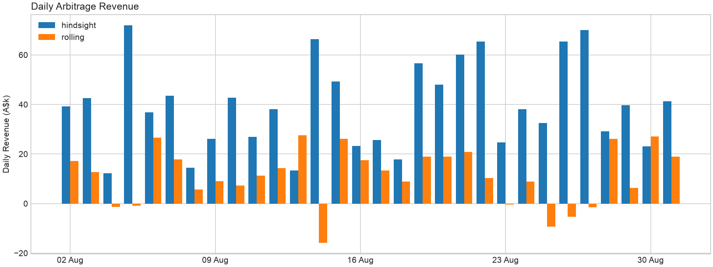

# NEM battery arbitrage

This repository contains a simple optimisation algorithm that determines
how much theoretical arbitrage a 100 MW / 200 MWh
battery can capture in South Australia in August 2026 without knowing future regional reference prices (RRPs) that AEMO publishes every 5-minute interval and compares the results to a perfect hindsight scenario.

## Setup and running the model

The project assumes you have [uv](https://docs.astral.sh/uv/getting-started/installation/) installed.

Commands below should be invoked in the root directory of this repository.

```
uv sync # installs package dependencies
uv run nem-battery # runs arbitrage model 
``` 

The run takes about two minutes on a laptop.

## Code Structure

All Python modules can be found in `nem_battery/`. They are listed here in the order the model uses them.

1. **config.py.** All constants used in the model; interval lengths, region, month, file paths, the battery specs and the rolling window settings.
2. **types.py.** Every dataclass: `Battery` (ratings plus current state of charge), `RollingWindow`, the `Dispatch` a solve returns, and `Revenue`.
3. **data.py.** Downloads AEMO's public monthly "Aggregated Price and Demand" CSV for a given month and caches it in `data/raw/`. Cached data is parsed and localised to NEM time (UTC+10).
4. **model.py.** The mixed-integer linear program (MILP) written in PuLP and solved with CBC.
5. **dispatch.py.** The two ways of using the model.
   - *Perfect hindsight*: one solve over the whole period with actual prices.
   - *Rolling window*: every 30 minutes, solve a 24 hour lookahead using a naive forecast which is: assume today's price at a given interval is yesterday's price for the same interval, commit only the next 30 minutes then repeat.
6. **metrics.py.** Postprocesses solution to generate headline metrics and data for plotting.
7. **plots.py.** Daily revenue bar chart.
8. **cli.py.** The entry point. Runs the steps above in order and writes
   `summary.json`, `dispatch_schedule.csv` and `daily_revenue.png`
   to `data/outputs/`.

## Optimisation Math Model
### Parameters

| Symbol | Definition |
|---|---|
| $T$ | Number of intervals being solved |
| $\Delta$ | Interval length in hours |
| $p_t$ | RRP in interval $t$ in A\$/MWh |
| $P$ | Power rating, MW |
| $E$ | Energy capacity, MWh |
| $s_0$ | State of charge at the start of the period, MWh |

### Decision variables, one set per interval $t = 1, \dots, T$

$$
c_t \in [0, P] \quad \text{charge, MW} \qquad
d_t \in [0, P] \quad \text{discharge, MW} \qquad
s_t \in [0, E] \quad \text{state of charge, MWh} \qquad
b_t \in \{0, 1\} \quad \text{1 if charging}
$$

### Objective

Maximise revenue from selling minus buying energy at the RRP:

$$
\max \sum_{t=1}^{T} \Delta (d_t - c_t) p_t
$$

### Constraints

**Energy balance**

$$
s_t = s_{t-1} + \Delta (c_t - d_t) \qquad t = 1, \dots, T
$$

**No simultaneous charge and discharge**

$$
c_t \le P b_t \qquad d_t \le P (1 - b_t) \qquad t = 1, \dots, T
$$

**End state must match start state if $T$ is the final interval of the month (so that revenue reflects arbitrage)**

$$
s_T = s_0
$$


## Headline numbers

| Mode | Revenue (A$) | Revenue per MW per year (A$) |
|---|---|---|
| Perfect hindsight | 1,184,271 | 144,185 |
| Rolling window | 337,405 | 41,079 |

A battery run using naive forecasts captured **28%** of the
hindsight revenue over the month.

Two things stand out in `daily_revenue.png`:

- The highest price was A$376/MWh, and no single day dominates.
- The naive strategy lost money on 7 of the 30 days.



## Limitations

- Assumes dispatch at every interval has no effect on regional price and that dispatch at solved MW quantity is achieved.
- Ignores FCAS markets.
- No network constraints.
- Uses a naive RRP forecast.
- Assumes perfect round-trip efficiency. Real batteries lose 10 to 15% per cycle.
- Assumes simplified battery behaviour e.g. no temperature or SoC-dependent limits etc.
- Battery cycling and degradation are not considered at all. Nothing limits how often the battery cycles.
- Results are only shown for a single month.